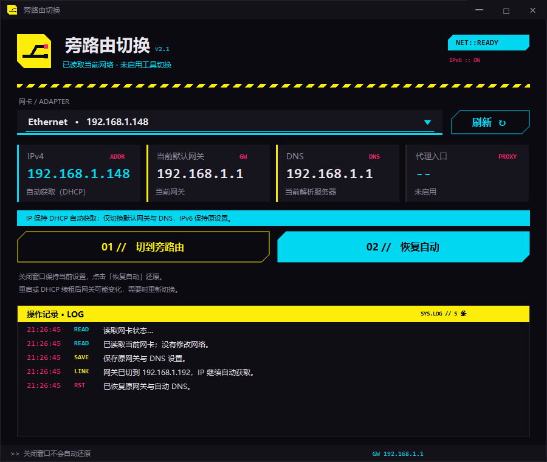

<p align="center">
  
</p>

<h1 align="center">NetworkSwitch</h1>

<p align="center">
  <strong>Switch your Windows gateway in one click.</strong><br>
  Windows 旁路由切换工具 · 保持 DHCP 自动获取 IP · 一键恢复原配置
</p>

<p align="center">
  <a href="https://github.com/ziwuxin1/NetworkSwitch/releases/tag/v2.3.1"></a>
  
  
  
</p>

<p align="center">
  <a href="https://github.com/ziwuxin1/NetworkSwitch/releases/latest">下载程序</a> ·
  <a href="#快速开始">快速开始</a> ·
  <a href="#功能一览">功能一览</a> ·
  <a href="#开发与构建">开发与构建</a> ·
  <a href="#版本说明">版本说明</a>
</p>

---

## 界面预览



<sub>界面预览使用模拟网络数据，仅展示布局与操作状态，不代表当前电脑的实际网络配置。</sub>

## 项目介绍

在主路由与旁路由之间切换时，手动修改网关和 DNS 容易漏改，也不方便还原。**NetworkSwitch** 将这一步整理成两个操作：切到旁路由、恢复原配置。

程序采用 C# WinForms 界面和 PowerShell 网络操作脚本。切换时保留 DHCP 地址和原默认网关，添加指向 `192.168.1.192` 的 IPv4 路由并设置 DNS，保存原配置用于恢复。**v2.3.1 开启后，退出程序和重启电脑都保留旁路由，直到手动恢复。**

## 功能一览

| 功能 | 说明 |
| --- | --- |
| 一键切换 | 使用两条 IPv4 `/1` 路由与 DNS，将流量交给旁路由 `192.168.1.192`，保留原 DHCP 默认网关。 |
| 保留自动 IP | IPv4 地址保持 DHCP 自动获取，无需手动填写静态地址。 |
| 一键恢复 | 清除当前及重启保留的工具路由，恢复原 DNS 与 IPv6 设置；失败时保留恢复记录。 |
| 网卡选择 | 选择需要切换的网卡，查看当前网络状态。 |
| 状态展示 | 展示 IPv4、默认网关、DNS 和代理入口状态。 |
| 操作记录 | 在窗口内查看读取、保存、切换和恢复过程。 |
| 重启后保持 | 路由和 DNS 一起保存，无需开机启动程序；需要还原时重新打开本版本。 |
| 只读检查 | 后台每 15 秒读取状态，不自动切换、补路由或改 DNS。 |
| 手动修复 | 显式补回缺失的当前或持久路由；旧版配置需先还原再开启。 |
| 托盘菜单 | 关闭窗口进入托盘，可选择保留配置退出，或恢复并退出。 |
| Cyberpunk 界面 | 黑黄与青色配色、切角按钮、自定义下拉框和内嵌 Logo。 |

## 下载

**[下载 macOS 1.0.0 正式版](https://github.com/ziwuxin1/NetworkSwitch/releases/tag/macos-v1.0.0)**：原生窗口和菜单栏版本，支持 Apple 芯片与 Intel，最低 macOS 13；包含 IPv6 隧道路由引起的 VPN 误报修复。见 [macOS 使用说明与构建方法](macos/README.md)。Windows 下载如下。

**[下载 NetworkSwitch v2.3.1 完整包](https://github.com/ziwuxin1/NetworkSwitch/releases/download/v2.3.1/NetworkSwitch-v2.3.1.zip)**

| 文件 | 用途 |
| --- | --- |
| [NetworkSwitch-v2.3.1.zip](https://github.com/ziwuxin1/NetworkSwitch/releases/download/v2.3.1/NetworkSwitch-v2.3.1.zip) | 推荐下载，包含 EXE、中文使用说明、源码及验证摘要。 |
| [NetworkSwitch-Cyber-v2.3.1.exe](https://github.com/ziwuxin1/NetworkSwitch/releases/download/v2.3.1/NetworkSwitch-Cyber-v2.3.1.exe) | 独立程序，下载后直接运行。 |
| [SHA256SUMS.txt](https://github.com/ziwuxin1/NetworkSwitch/releases/download/v2.3.1/SHA256SUMS.txt) | EXE 和 ZIP 的 SHA-256 校验值。 |
| [source/](source/) | 在线查看源码、构建脚本、图标和模拟测试。 |

此仓库已公开，可直接查看源码和下载程序，无需仓库访问权限。正式版本及校验文件见 [Releases](https://github.com/ziwuxin1/NetworkSwitch/releases/latest)。

## 快速开始

1. 下载并解压完整 ZIP；旧版若仍在运行，先还原并退出（留意托盘）。
2. 退出 Clash Verge 等电脑 VPN/TUN，避免与旁路由同时接管网络。
3. 双击 `NetworkSwitch-Cyber-v2.3.1.exe`，允许管理员权限。
4. 若提示 **「旧版临时配置」**，先点击 **「恢复自动」**，成功后再开启新版。
5. 选择连接 `192.168.1.x/24` 家庭网络的网卡，点击 **「切到旁路由」**，确认显示 **「重启保留」**。
6. 此后重启无需重新打开程序。需要恢复时，重新打开本版本并点击 **「恢复自动」**。

正常使用无需安装 Python，也无需单独运行 PowerShell 脚本。旁路由地址需要能够从所选网卡访问。

## 网络行为

- **IPv4 地址保持 DHCP 自动获取**，`ipconfig` 中的本机 IP 不一定会改变。
- 原默认网关显示 `192.168.1.1` 属正常现象；更具体的两条路由将 IPv4 流量交给 `192.168.1.192`，本地局域网更具体的路由仍优先。
- **路由和 DNS 重启后都保留**，不依赖程序常驻、开机启动或计划任务。
- 关闭窗口进入托盘。「退出（保留当前配置）」仅退出程序；「恢复并退出」会还原网络。
- 后台只读检查。检测异常时不会反复切换，配置缺失时可点击「手动修复」。手动操作失败时会尝试回滚，恢复失败会保留备份供重试。
- IPv6 保持原配置，不随 IPv4 网关切换。
- 换网络或改用电脑 VPN 前，请先恢复原配置。IPv4 地址、其他网卡、MTU、路由器及 NAS 设置不在修改范围内。
- 新版使用 Schema 2 恢复记录；开启后请使用 v2.3.1 或兼容版本还原，旧版无法处理持久路由备份。
- 程序不提供代理节点。网页、视频或其他服务是否可用，取决于旁路由代理、DNS 和分流配置。

## 开发与构建

使用 Windows PowerShell 和 Windows .NET Framework C# 编译器。

```powershell
.\source\build.ps1
```

构建脚本会将 `NetworkWorker.ps1`、程序图标及 manifest 嵌入 EXE，输出至项目根目录：

```text
NetworkSwitch-Cyber-v2.3.1.exe
```

运行网络逻辑模拟检查：

```powershell
.\source\Test-Simple.ps1 -Scratch "$env:TEMP\NetworkSwitch-tests"
.\source\Test-Ui.ps1
```

这些检查替换系统网络操作，不会实际切换电脑网关。图标已经包含在仓库中；仅重新运行 `make-icon.py` 生成图标时需要 Python 和 Pillow。

| 文件 | 职责 |
| --- | --- |
| `source/NetworkSwitch.cs` | WinForms 界面、状态显示及操作入口。 |
| `source/NetworkWorker.ps1` | 网络信息读取、当前及持久路由、DNS 切换与恢复。 |
| `source/build.ps1` | Windows EXE 构建脚本。 |
| `source/Test-Simple.ps1` | 网络逻辑模拟检查。 |
| `source/Test-Ui.ps1` / `source/Test-Ui.cs` | 定时回调、手动操作和状态展示检查。 |
| `source/app.manifest` | Windows 应用程序 manifest。 |
| `source/NetworkSwitch.ico` | 多尺寸程序图标。 |
| `source/make-icon.py` | 图标生成工具。 |

## 版本说明

| 版本 | 内容 |
| --- | --- |
| **v2.3.1** | 修复托盘显示 Windows 默认图标，改用程序内嵌图标。 |
| v2.3.0 | 路由与 DNS 重启后一起保留；恢复时清理两个路由表；后台只读检查；修复还原失败后又重新添加路由的问题；兼容旧版恢复记录。 |
| v2.1.1 | Cyberpunk 界面、内嵌 Logo、自定义深色下拉框；历史版本仍可在 Releases 下载。 |

**本次验证：**v2.3.1 编译及内嵌图标提取通过，15 项模拟界面检查通过；未执行真实托盘目视检查或网络切换。见 [本次验证摘要](docs/validation-v2.3.1.txt)。此前网络逻辑验证见 [v2.3.0 验证摘要](docs/validation-v2.3.0.txt)。

持久路由语义参考 [Microsoft New-NetRoute 文档](https://learn.microsoft.com/en-us/powershell/module/nettcpip/new-netroute#-policystore)。

